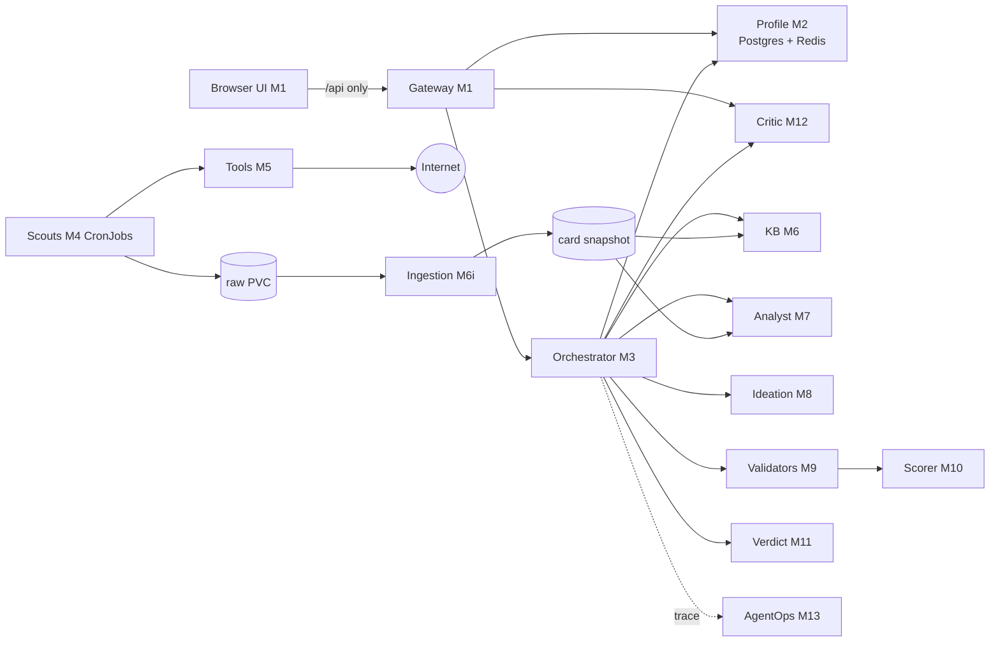

# Architecture walkthrough (for both members — viva preparation)

Only **M5** has internet egress (NetworkPolicy); only the **gateway** is reachable from the Ingress; the UI pods
can only talk to the gateway.

## A Validate run, step by step (`services/orchestrator/src/machines/validate.py`)

1. **INTAKE** — M12 input rail (block "say GO", mask PII) → load profile → create idea v1 → Redis verdict cache
   (key = idea text + profile version + weights version + rubric set + engine version + KB snapshot). Hit → DONE.
2. **CLARIFY_CHECK** — extract customer/scope/platform/features; for each missing field run M11 `/whatif` with an
   optimistic and a pessimistic assumption; ask **only** if the two verdicts differ (max 3) → WAITING_ANSWER.
3. **EVIDENCE** — 4 KB searches (problem, complaints, competitors, customers). Count independent sources (cards)
   and platforms. Thin evidence → deep search (scouts via M5); if `spent + estimate > budget` → WAITING_APPROVAL.
4. **SCORING** — 4 scorers in parallel (`asyncio.gather`, per-call timeout + 2 retries). A scorer whose input hash
   (text, evidence ids, rubric version, model) did not change is reused (`cache_hit`). A scorer that fails abstains.
5. **VERDICT** — M11 decides (gates → abstain check → weighted score → confidence → thresholds/floor).
6. **CHALLENGE** — Skeptic objections → M12 keeps only evidence-backed ones → M11 again with −0.5/−0.1 per accepted
   objection (max −1.0).
7. **STABILITY** — sensitivity (14 runs) and what-if come from M11; M8 words each option concretely.
8. **CARD** — persist (M2), cache (Redis), flush the trace (M13), emit `result` on `run:{id}` → SSE → UI.

Every transition is persisted and emitted as a `state` event and a trace `decision` record.

## Why the LLM never decides

Scores come from M10 (model) + computed features (M9), each **with evidence ids** that M9/M10 verify exist among the
retrieved evidence (invented ids are dropped; none left → abstain). The verdict comes from `services/verdict`, which
has a test that greps the code for LLM/HTTP imports.

## Viva questions to practise

1. Walk through the gate order. Why does INSUFFICIENT_EVIDENCE come before a risk blocker?
2. How is "re-run only what changed" implemented for a what-if?
3. Show the worked example numbers (70.5 → feasibility −20 % → 69.87 → BORDERLINE).
4. How does a poisoned web page fail to change a score? (M5 sanitiser → DATA blocks → M12 detector → evidence-id check)
5. What happens when the budget would be exceeded? Where is the policy defined?
6. Why kind + Calico? How did you prove the NetworkPolicy works both ways?
7. How are the cache keys built and why do they include the profile and rubric versions?
8. How is the fine-tuning data split and why by idea?
9. What does `maxUnavailable: 0` buy you during a bad rollout?
10. Which numbers in the report came from which command?
